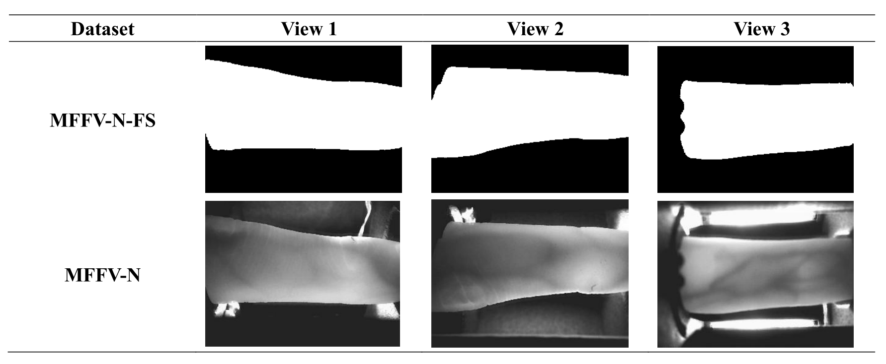

# Note: 

### This repository was originally developed at the SCUT BIPLab ([SCUT-BIP-Lab/FinSeg](https://github.com/SCUT-BIP-Lab/FinSeg))

# MFFV-N-FS Dataset Requirement

### 1. MFFV-N-FS dataset Introduction

The MFFV-N-FS dataset is the Finger Shape dataset originate from the MFFV-N (Normal-finger-orientation part of Mirror-based Full-view Finger Vein) dataset[1]. It is segmented using the FinSeg-Net[2]. We also provide the experimental protocol (save as ‘.csv’ files) for the following studies that use this dataset.

### 2. Example

The MFFV-N-FS dataset comprises 9,600 images collected from 320 fingers. For each finger, 10 images were captured across 3 distinct perspectives. The naming format is: ‘finger_orientation_illumination_view_sample.bmp;. Following shows an full-view finger shape example

### **3. Requirement**

To get the MFFV-N-FS dataset, please sign a license agreement (MFFV-N-FS License Agreement.pdf). Please note that the application is only valid if it is made by a regular employee of the applying entity

### 4. Citations

<u>*[1] J. Huang, Z. Li, S. Bhattacharjee, S. Marcel and W. Kang, "Mirror-Based Full-View Finger Vein Authentication With Illumination Adaptation," in IEEE Transactions on Circuits and Systems for Video Technology, vol. 35, no. 3, pp. 2057-2073, March 2025, doi: 10.1109/TCSVT.2024.3490581.*</u>

<u>*[2] J. Huang, D. Luo, W. Yang, J. Pan and W. Kang, "Study of Finger Biometrics on Finger Semantic Segmentation and Finger Shape Authentication," 2025 IEEE International Conference on Multimedia and Expo (ICME), Nantes, France, 2025, pp. 1-6, doi: 10.1109/ICME59968.2025.11209418.*</u>

### **5. Contact**

For further questions/discussions/cooperations, contact Junduan Huang, Email: [runrunjun@163.com](mailto:runrunjun@163.com)